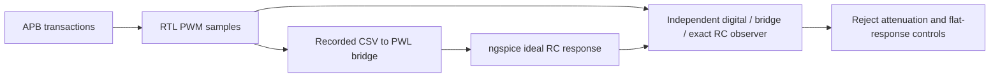

# APB PWM to ideal RC demonstration

An APB-controlled PWM produces recorded digital samples. A feed-forward PWL bridge drives an ideal 10 kohm / 100 nF RC filter in ngspice. Five duty settings passed 80 periods each and 102,898 digital checks. Settled means met the 5 mV limit, and full responses agreed with an independent exact PWL/RC solution within 0.5 mV. Half-scale ripple measured 115.043 mV peak-to-peak. Bridge attenuation and flat-output negative controls were rejected.

- [Quick start](#quick-start)
- [How it works](#how-it-works)
- [What runs](#what-runs)
- [Repository layout](#repository-layout)
- [Individual stages](#individual-stages)
- [Results and controls](#results-and-controls)
- [Troubleshooting](#troubleshooting)
- [Reports and limits](#reports-and-limits)
- [Licence](#licence)

The implementation and whitepaper were locally verified on 27 October 2026. **Crucible is beta.** These are bounded engineering demonstrations, with the exclusions below.

## Included files

`rtl/apb_pwm.v` owns the register interface and PWM. `tests/tb.v` records actual RTL samples. `scripts/bridge.py` converts them to PWL input. `verify.py` independently checks bridge levels/transitions and integrates the RC equation to compare all saved analogue samples.

The reviewed [PDF](docs/APB_PWM_RC_Mixed_Signal_Demo_Ignytion_A4.pdf) and [editable A4 PowerPoint](docs/APB_PWM_RC_Mixed_Signal_Demo_Ignytion_A4.pptx) are included. [Compact evidence](evidence/summary.json) records measured outcomes; [document hashes](evidence/documents.sha256.json) bind the final copies. Generated build artifacts and raw logs remain local and are excluded from Git.

## Quick start

Open a Linux/WSL terminal in this repository root. Crucible is beta. Managed Icarus and ngspice are pinned by the lock. A compatible FFTW native library must be available through the system loader or NGSPICE_RUNTIME_DIR. No PDK is needed for the ideal source and RC filter. The managed setup target installs pinned NumPy into ignored build/observer.

```sh
igny init
igny workspace sync
igny tool install make --version 4.4.1 --env ams-pwm-rc
igny run --env ams-pwm-rc make setup
igny run --env ams-pwm-rc make check
```

For a separate FFTW directory, pass NGSPICE_RUNTIME_DIR to Make or configure ignored local.env.sh using [config/example.env.sh](config/example.env.sh). Supply your own runtime; the release workflow does not copy libraries from another demonstration.

Run the complete experiment after satisfying those prerequisites:

```sh
igny run --env ams-pwm-rc make run NGSPICE_RUNTIME_DIR=/path/to/fftw-libraries
```

Every executable example in this guide goes through Igny. Make delegates to the supplied stage scripts and observers; failed stages stop the workflow. Make 4.4.1 is installed separately from the existing engineering-tool lock. The setup target uses the Igny-launched Python interpreter to install requirements.txt into an ignored project-local prefix at build/observer, then checks the imported module locations. It does not change system Python or a shared tool payload. The check target checks observer imports; it does not qualify a PDK or native-library installation.

## How it works

An APB-controlled counter produces real digital samples for five duty values. Those samples become 0/1.8 V PWL sources for an ideal 10 kohm / 100 nF RC filter. The observer independently integrates the piecewise-linear input, comparing the full saved response as well as settled means. This is a recorded feed-forward bridge.



## What runs

| Component | Pinned version |
|---|---|
| iverilog | 14.0.0 |
| ngspice | 46 |

The lock restores those engineering tools; the setup target prepares only project-local observer dependencies where needed. Initial acquisition may require network access. Native Windows/macOS/ARM tool execution and independent clean-machine reproduction are not established by these results.

## Repository layout

```text
.
|-- Makefile             Managed workflow entry points
|-- crucible.toml        Workspace selection
|-- crucible.lock        Engineering-tool identities
|-- rtl/                 APB register interface and PWM
|-- tests/               Digital observer and CSV capture
|-- scripts/             PWL bridge, exact RC observer and managed workflow
|-- config/              Native runtime example
|-- docs/                Reviewed PDF and editable PowerPoint
|-- evidence/            Compact reviewed measurement snapshots
`-- build/               Generated local artifacts; ignored by Git
```

## Individual stages

Run these from the same prepared workspace. Stages use earlier outputs; execute them in the listed order when reproducing the flow manually. The run target performs the full ordered workflow.

| Managed command | Work performed |
|---|---|
| `igny run --env ams-pwm-rc make digital` | Simulate five duty settings, 80 periods each, and save actual PWM samples |
| `igny run --env ams-pwm-rc make analogue` | Convert the recorded samples into PWL sources and run all five RC simulations |

Inspect or recheck existing results without rebuilding:

```sh
igny run --env ams-pwm-rc make smoke
igny run --env ams-pwm-rc make report
igny run --env ams-pwm-rc make help
```

The smoke target validates existing generated evidence. It is not a new experiment run. The report target prints local summaries and fails if required results are absent. The sed target normalises only public shell inputs to LF; run invokes it automatically.

## Results and controls

Require APB_PWM_BRIDGE_AND_RC_REFERENCE_VERIFIED. The digital bench checks 102,898 comparisons. Settled means must meet the 5 mV limit and full responses the 0.5 mV reference tolerance. Recorded half-scale ripple is approximately 115.043 mV peak-to-peak. Bridge attenuation and a flat midscale response must both be rejected.

Expected negative failures are handled by the existing runners/observers. Missing tools, compilation failures, timeouts and missing artifacts do not count as successful controls. Changing sources or inputs requires rerunning the affected stages and their dependents. Raw logs and generated runtime/PDK payloads remain local.

## Troubleshooting

| Symptom | Check / next action |
|---|---|
| Wrong workspace or missing tool | Open the terminal in the root containing crucible.toml; use the explicit project environment in this guide and restore the lock. |
| Make is not bound | Repeat the managed Make installation in Quick start. |
| Observer dependency is absent or changed | Repeat the managed setup target; retain the pinned requirements. |
| Native library or PDK is missing | Supply the prerequisites described above. Lock restoration and observer setup do not provision them. |
| Evidence is missing or stale | Run the full workflow or the affected stages in order. Preserve the reported failure instead of editing expected values. |
| Negative control unexpectedly passes | Treat the guard as failed and inspect its artifacts. |

## Reports and limits

Read the [technical report](docs/APB_PWM_RC_Mixed_Signal_Demo_Ignytion_A4.pdf) or its [editable PowerPoint](docs/APB_PWM_RC_Mixed_Signal_Demo_Ignytion_A4.pptx). The documents record measured results and exclusions; source commands in this README are the current managed workflow.

Ideal source and components, sampled digital time and static duties. No live bidirectional co-simulation, transistor driver, tolerances, noise/PVT, feedback, physical hardware, exhaustive APB certification or signoff.

Review the source/document package locally with:

```sh
igny run --env ams-pwm-rc make preflight
```

This checks the public candidate and document hashes; it does not publish anything or rerun engineering verification.

## Licence

Dependencies retain their upstream licences and credit. This checkout has no project-wide licence grant; the owner must select the intended project licence before presenting it as an open-source release. No upstream endorsement is implied.

Source repository: [CRUCIBLE-WORKBENCH/AMS_PWM_RC](https://github.com/CRUCIBLE-WORKBENCH/AMS_PWM_RC).
